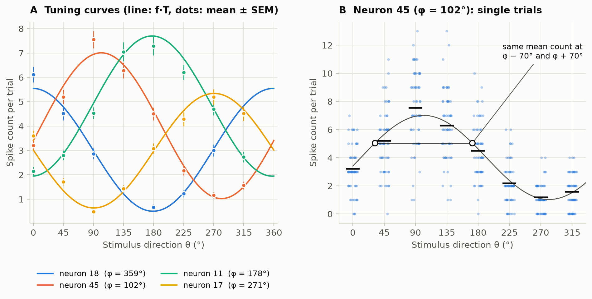
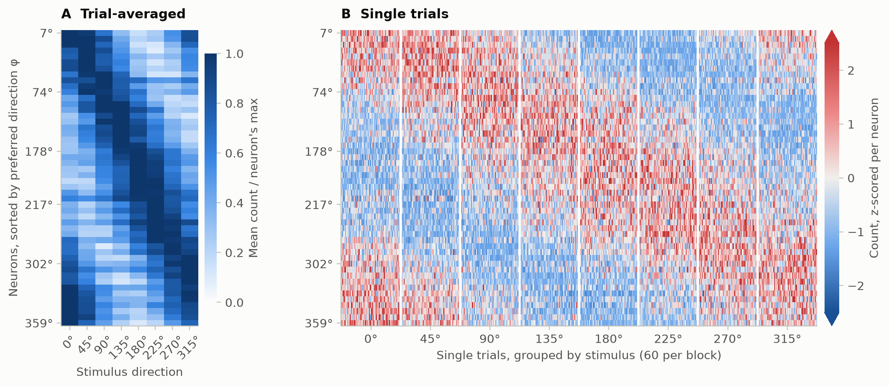
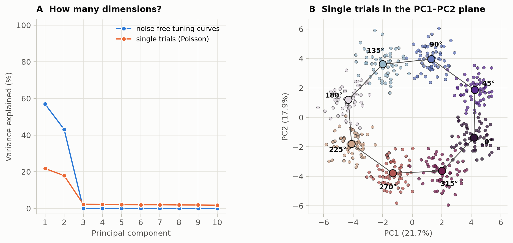
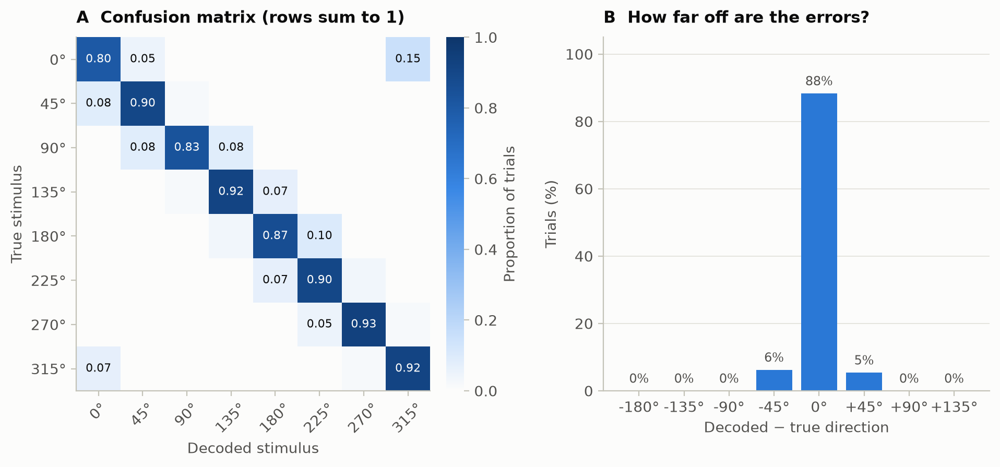
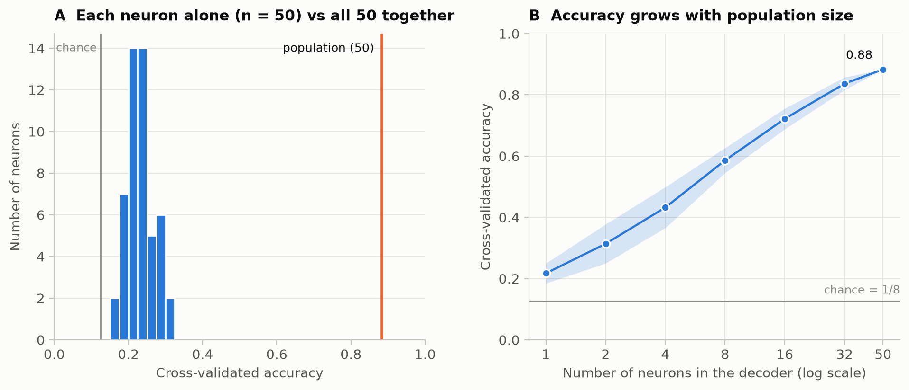

<div align="center">

# One Neuron Versus a Population: Decoding Stimulus Direction from Simulated Cosine-Tuned Neurons With Poisson Noise

**Tiago Souto Rocha**

NUTES and NeuroComp research group, Universidade Estadual da Paraíba (UEPB), Campina Grande, Brazil

October 2026

</div>

---

## Abstract

Neurons in sensory and motor cortex are broadly tuned and noisy, so the response of any single cell is an unreliable report of the stimulus. We asked how much a population gains over its individual members, using a minimal simulation of 50 neurons with cosine tuning to stimulus direction and independent Poisson spike counts, presented with 8 directions (60 trials each, 0.2 s counting window). The trial-averaged population response formed a ring ordered by direction, principal component analysis (PCA) showed that the noise-free responses lie exactly in a two-dimensional plane, while Poisson noise spread single-trial variance across all dimensions. A cross-validated linear decoder recovered the stimulus on 88.3% of single trials (chance 12.5%; permutation p = 0.005), and every error fell on a neighbouring direction. Neurons decoded alone reached 23.1% on average (best 32.3%), and accuracy rose steadily as neurons were added. Two mechanisms account for the gain: heterogeneous preferred directions break the symmetry that makes each cosine tuning curve ambiguous, and independent noise averages out across neurons.

**Keywords:** population coding · cosine tuning · Poisson variability · neural decoding · principal component analysis · cross-validation

---

## 1. Introduction

Single neurons in motor cortex fire most for movements in a preferred direction and progressively less for directions farther away. Georgopoulos and colleagues showed that, for most tuned cells, this directional tuning is well described by a cosine function, and that preferred directions differ across cells, so that tuning curves overlap (Georgopoulos et al., 1982). They proposed that movement direction is represented not by any one cell but by the cooperation of many: a population code (Pouget et al., 2000).

A single cosine-tuned neuron is a poor reporter of direction for two reasons. First, its tuning curve is symmetric around the preferred direction, so two directions on either side of it evoke the same mean firing rate. Second, spike counts vary from trial to trial, so the counts evoked by neighbouring directions overlap. A population with diverse preferred directions can, in principle, resolve both problems.

Here we quantify this with a simulation built from the two ingredients above, cosine tuning and Poisson spike-count noise, and ask:

> **Why can a population of neurons tell stimuli apart when a single neuron cannot?**

We describe the population response with heatmaps and PCA, then decode the stimulus from single trials with a cross-validated classifier, comparing single neurons with populations of increasing size. The stimulus set (8 directions, 45° apart) mirrors the 8 movement directions used by Georgopoulos et al. (1982).

## 2. Methods

### 2.1 Simulated population

Each neuron $i$ ($i = 1,\ldots,50$) has a preferred direction $\varphi_i$, a baseline rate $b_i$ and a gain $g_i$. Its mean firing rate for a stimulus moving in direction $\theta$ is:


```math
f_i(\theta)
=
b_i
+
g_i\frac{1+\cos(\theta-\varphi_i)}{2}.
```


Therefore,


```math
b_i \leq f_i(\theta) \leq b_i+g_i.
```


On each trial, the spike count of every neuron in a window of $T$ seconds is drawn independently:


```math
n_i \sim \mathrm{Poisson}\!\left(f_i(\theta)\,T\right).
```


Noise is therefore private to each neuron (no noise correlations), and the variance of each count equals its mean (Fano factor 1). Parameters are listed in Table 1. As a sanity check, the empirical means were compared with $f_i(\theta)T$ and the Fano factor was computed for every neuron and stimulus.

**Table 1.** Simulation and analysis parameters.

| Parameter | Value |
|---|---|
| Neurons | 50; preferred directions drawn uniformly on [0°, 360°) |
| Baseline, gain | Uniform(2, 10) Hz, Uniform(10, 30) Hz |
| Stimuli | 8 directions: 0°, 45°, …, 315° |
| Trials | 60 per stimulus (480 in total) |
| Counting window $T$ | 0.2 s |
| Cross-validation | stratified 5-fold, shuffled with the seed |
| Permutation test | 200 label permutations |
| Neuron dropping | n = 1, 2, 4, 8, 16, 32, 50; 20 random subsets per size |
| Random seed | 2026 |

### 2.2 Population response and PCA

Trial-averaged responses were normalised to each neuron's maximum mean count and displayed with neurons sorted by preferred direction. Single trials were z-scored per neuron.

Expanding the tuning equation above gives:


```math
f_i(\theta)
=
\left(b_i+\frac{g_i}{2}\right)
+
\frac{g_i}{2}\cos\varphi_i\,\cos\theta
+
\frac{g_i}{2}\sin\varphi_i\,\sin\theta.
```


After the mean is removed, the noise-free population response therefore lies in a two-dimensional plane and traces a closed curve (a ring) as $\theta$ goes around the circle. We tested this prediction with PCA on the noise-free responses at 360 directions, and compared it with PCA on the z-scored single trials. PCA was used for visualisation only and played no part in decoding (Cunningham & Yu, 2014).

### 2.3 Decoding

The stimulus was decoded from the vector of single-trial spike counts with L2-regularised multinomial logistic regression (scikit-learn defaults, C = 1). Counts were standardised inside a pipeline, so the scaling was fitted on the training folds only. Performance was estimated with stratified 5-fold cross-validation, so each test fold held 12 trials per stimulus.

Significance was assessed with a label-permutation test (Ojala & Garriga, 2010). The stimulus labels were shuffled 200 times, the whole pipeline was refitted and cross-validated each time, and the p-value was computed as:


```math
p = \frac{C+1}{N_{\mathrm{perm}}+1},
```


where $C$ is the number of permutations whose accuracy matched or exceeded the real one. With 200 permutations, the smallest attainable value is $1/201 \approx 0.005$. Errors were summarised by a confusion matrix built from cross-validated predictions and by the distance between the decoded and the true direction, wrapped onto the circle.

### 2.4 Single neurons versus the population

The same decoder and cross-validation splits were applied to:

1. each neuron alone; and
2. random subsets of $n = 1, 2, 4, 8, 16, 32,$ and $50$ neurons.

Twenty subsets were drawn without replacement for each population size, producing a neuron-dropping curve.

### 2.5 Software

All analyses were run in Python 3.11 with NumPy, SciPy, scikit-learn and Matplotlib, using the versions pinned in `requirements.txt`. Every random number derives from a single seed. Instructions to reproduce every number and figure are given in [Appendix A](#appendix-a-reproducing-the-results).

## 3. Results

### 3.1 Simulated counts behave as intended

Expected counts ranged from 0.51 to 7.70 spikes per trial. The mean absolute difference between empirical and expected counts was 5.7% of the mean expected count, and the median Fano factor was 1.00, as expected for Poisson counts. Figure 1A shows the tuning of four example neurons. Figure 1B illustrates both sources of single-neuron ambiguity: directions placed symmetrically around the preferred direction evoke the same mean count, and single-trial counts for neighbouring stimuli overlap widely.



**Figure 1. Cosine tuning and Poisson variability.** **(A)** Tuning curves of four example neurons with preferred directions near 0°, 90°, 180° and 270°. Lines show the expected count $f_i(\theta)T$; dots show the mean ± SEM over 60 trials. **(B)** Single-trial counts of one neuron (preferred direction 102°). Horizontal bars mark the mean for each stimulus; open circles mark two directions, 70° on either side of the preferred direction, that evoke the same expected count.

### 3.2 The population response forms a ring

With neurons sorted by preferred direction, the trial-averaged response showed a diagonal band that wrapped around from 315° back to 0°: each stimulus activated the neurons tuned near it (Fig. 2A). The band remained visible in single trials, but each trial was noisy (Fig. 2B).



**Figure 2. Population response.** **(A)** Trial-averaged counts, normalised to each neuron's maximum, with neurons sorted by preferred direction. **(B)** Single trials, z-scored per neuron, grouped by stimulus (60 trials per block).

As predicted by the expanded tuning equation, the first two principal components captured 100% of the variance of the noise-free responses (Fig. 3A). In single trials, PC1 and PC2 together explained 39.6% of the variance, and every later component explained about 2% (PC3: 2.3%), a flat noise floor produced by independent Poisson noise. In the PC1–PC2 plane the stimulus means lay on a ring in the order of the directions, with 315° next to 0°. Single-trial clouds overlapped mostly with their neighbours on the ring.



**Figure 3. Low-dimensional geometry.** **(A)** Variance explained by the first 10 principal components of the noise-free responses (360 directions) and of the z-scored single trials. **(B)** Single trials projected onto PC1 and PC2, coloured by stimulus direction on a cyclic colour scale. Large markers show the stimulus means, joined in order of direction.

### 3.3 The population decodes direction far above chance, and its errors are local

The full population decoded the stimulus on 88.3% ± 3.6% of held-out trials (mean ± SD over 5 folds), against a chance level of 12.5%. Decoders trained on shuffled labels scored 12.4% ± 1.9%. No permutation reached the real accuracy, giving $p = 0.005$, the smallest value attainable with 200 permutations. Per-stimulus accuracy ranged from 0.80 (0°) to 0.93 (270°) (Fig. 4A). Every error assigned a trial to a neighbouring direction, ±45° away (Fig. 4B), matching the neighbour overlap seen in Fig. 3B.



**Figure 4. Decoding performance.** **(A)** Confusion matrix from cross-validated predictions; each row sums to 1. Values below 0.05 are not printed. **(B)** Distribution of the difference between the decoded and the true direction, wrapped onto the circle.

### 3.4 A population outperforms its best member

Decoded alone, single neurons reached a mean accuracy of 23.1%, ranging from 16.9% to 32.3% (Fig. 5A). The best one is the neuron shown in Fig. 1B. The population of 50 was 3.8 times more accurate than the average neuron and far above the best. Accuracy rose monotonically with the number of neurons and was still rising at $n = 50$ (Fig. 5B; Table 2).



**Figure 5. Single neurons versus the population.** **(A)** Cross-validated accuracy of each neuron decoded alone (n = 50). The grey line marks chance and the orange line the full population. **(B)** Accuracy as a function of the number of neurons in the decoder (mean ± SD over 20 random subsets; logarithmic axis).

**Table 2.** Decoding accuracy as a function of population size (mean ± SD over 20 random subsets).

| Neurons | 1 | 2 | 4 | 8 | 16 | 32 | 50 |
|---|---|---|---|---|---|---|---|
| Accuracy | 0.22 ± 0.03 | 0.31 ± 0.06 | 0.43 ± 0.07 | 0.59 ± 0.04 | 0.72 ± 0.03 | 0.84 ± 0.02 | 0.88 |

At $n = 50$ every subset is the full population, so there is no spread.

## 4. Discussion

A population of broadly tuned, noisy neurons identified stimulus direction on almost nine of ten single trials, whereas its individual members barely exceeded chance. The simulation isolates two mechanisms behind this gain.

**Symmetry breaking.** A cosine tuning curve cannot tell $\varphi_i-\delta$ from $\varphi_i+\delta$ (Fig. 1B). Neurons with other preferred directions are confused by other pairs of stimuli, so an ambiguity in one neuron is resolved by another whose preference lies on one side of it. This requires heterogeneous preferred directions; a population of identically tuned neurons would inherit the ambiguity of its members.

**Noise averaging.** Because the Poisson noise is independent across neurons, evidence about the stimulus accumulates as neurons are added while noise partially cancels. With independent noise, the information carried by the population grows with its size (Averbeck et al., 2006), which is consistent with the curve in Fig. 5B still rising at $n = 50$.

**Geometry explains the errors.** Cosine tuning confines the noise-free response to a plane, where directions form a ring. Neighbouring directions are therefore neighbours in neural space, and single-trial noise blurs them into each other first. This explains why every decoding error fell on an adjacent direction (Fig. 4B).

**Limitations.** The model is deliberately minimal. First, noise was independent, whereas cortical noise correlations tend to be positive and larger for neurons with similar tuning (Averbeck et al., 2006; Moreno-Bote et al., 2014). Some correlations, namely those aligned with the signal (differential correlations), limit the information a population can carry no matter how many neurons are added (Moreno-Bote et al., 2014), so the steady gain seen here need not continue in vivo. Second, accuracy treats a 45° error and a 180° error alike; a circular error measure would describe a direction code better. Third, we used a single linear decoder, fixed counting window, random uniform preferred directions and one simulated dataset, so the specific numbers depend on these choices. Adding correlated noise is the natural next step.

## 5. Conclusion

In this simulation, the advantage of a population over a single neuron came from two simple properties: diverse preferred directions, which break the symmetry of each tuning curve, and independent noise, which averages out across neurons. The resulting population response is low-dimensional, and its geometry predicts which stimuli a decoder will confuse.

## References

- Averbeck, B. B., Latham, P. E., & Pouget, A. (2006). Neural correlations, population coding and computation. *Nature Reviews Neuroscience*, 7(5), 358–366. https://doi.org/10.1038/nrn1888
- Cunningham, J. P., & Yu, B. M. (2014). Dimensionality reduction for large-scale neural recordings. *Nature Neuroscience*, 17(11), 1500–1509. https://doi.org/10.1038/nn.3776
- Georgopoulos, A. P., Kalaska, J. F., Caminiti, R., & Massey, J. T. (1982). On the relations between the direction of two-dimensional arm movements and cell discharge in primate motor cortex. *Journal of Neuroscience*, 2(11), 1527–1537. https://doi.org/10.1523/JNEUROSCI.02-11-01527.1982
- Moreno-Bote, R., Beck, J., Kanitscheider, I., Pitkow, X., Latham, P., & Pouget, A. (2014). Information-limiting correlations. *Nature Neuroscience*, 17(10), 1410–1417. https://doi.org/10.1038/nn.3807
- Ojala, M., & Garriga, G. C. (2010). Permutation tests for studying classifier performance. *Journal of Machine Learning Research*, 11, 1833–1863. https://jmlr.org/papers/v11/ojala10a.html
- Pedregosa, F., et al. (2011). Scikit-learn: Machine learning in Python. *Journal of Machine Learning Research*, 12, 2825–2830. https://jmlr.org/papers/v12/pedregosa11a.html
- Pouget, A., Dayan, P., & Zemel, R. (2000). Information processing with population codes. *Nature Reviews Neuroscience*, 1(2), 125–132. https://doi.org/10.1038/35039062

---

## Appendix A. Reproducing the results

The notebook `population_coding_cosine_tuning.ipynb` contains the full simulation, every analysis and every figure. It needs no external data and runs in about 30 seconds. It is saved with its outputs, so GitHub shows every figure and printed result without running anything.

| Notebook section | Paper section | Figure |
|---|---|---|
| 1. The model | 2.1, 3.1 | `figures/fig01_tuning_curves.png` |
| 2. Heatmap of the population response | 2.2, 3.2 | `figures/fig02_heatmap.png` |
| 3. PCA of the population patterns | 2.2, 3.2 | `figures/fig03_pca.png` |
| 4. Decoding with cross-validation | 2.3, 3.3 | `figures/fig04_decoder.png` |
| 5. One neuron vs the population | 2.4, 3.4 | `figures/fig05_single_vs_population.png` |

### A.1 Requirements

- Python 3.11 (tested with 3.11.9 on Windows 11 and 3.11.17 on Linux)
- The packages pinned in `requirements.txt`: NumPy 2.4.6, SciPy 1.17.1, scikit-learn 1.9.1, Matplotlib 3.11.2
- Jupyter, to run the notebook (VS Code with the Jupyter extension, JupyterLab or Jupyter Notebook)

### A.2 Get the code

```bash
git clone https://github.com/tiagosoutorocha-neuro/population-coding.git
cd population-coding
```

### A.3 Create the environment

**Windows (PowerShell)**

```powershell
py -3.11 -m venv .venv
.\.venv\Scripts\Activate.ps1
python -m pip install --upgrade pip
python -m pip install -r requirements.txt jupyter
```

If PowerShell blocks the activation script, run:

```powershell
Set-ExecutionPolicy -Scope CurrentUser RemoteSigned
```

once, then activate the environment again.

**macOS / Linux**

```bash
python3.11 -m venv .venv
source .venv/bin/activate
python -m pip install --upgrade pip
python -m pip install -r requirements.txt jupyter
```

`requirements.txt` pins the libraries that produce the numbers. Jupyter is installed separately, without a pinned version, because it only runs the notebook and does not change the results.

### A.4 Run the notebook

**Interactively:** open `population_coding_cosine_tuning.ipynb`, select the `.venv` kernel, then restart the kernel and run all cells.

**From the terminal:** this runs every cell in order and saves the outputs into the notebook.

```bash
jupyter nbconvert --to notebook --execute --inplace population_coding_cosine_tuning.ipynb
```

The figures are written to `figures/`, which is created if it does not exist.

### A.5 Check the result

The last code cell prints a summary. A correct reproduction prints:

```text
Setup: 50 neurons, 8 directions, 60 trials/stimulus, T = 0.2 s, seed 2026

Single neuron (mean over 50)     : 0.231   (best 0.323)
Population of 50, Poisson noise   : 0.883   (permutation p = 0.0050; chance 0.125)
Noise-free tuning: PC1 + PC2       : 100.00% of variance
Single trials:     PC1 + PC2       : 39.6% of variance
```

### A.6 Notes on determinism

- All randomness comes from `SEED = 2026`. It is split with `np.random.SeedSequence(SEED).spawn(...)` into independent streams for the population parameters, the spike counts and the neuron subsets. The cross-validation splits and the permutation test use the same seed.
- Run the notebook top to bottom from a fresh kernel. Re-running a single cell advances its random stream and changes the numbers that follow.
- With the same operating system and package versions, the outputs are identical from run to run. Across operating systems, decoders fitted on a single neuron can differ very slightly because of floating-point differences.
- Changing any value in `P` gives a different, equally reproducible result.

### A.7 Repository structure

```text
.
├── population_coding_cosine_tuning.ipynb   # simulation, analyses and figures
├── requirements.txt                         # pinned package versions
├── figures/                                 # written by the notebook
│   ├── fig01_tuning_curves.png
│   ├── fig02_heatmap.png
│   ├── fig03_pca.png
│   ├── fig04_decoder.png
│   └── fig05_single_vs_population.png
├── .gitignore                               # excludes .venv/
└── README.md
```
